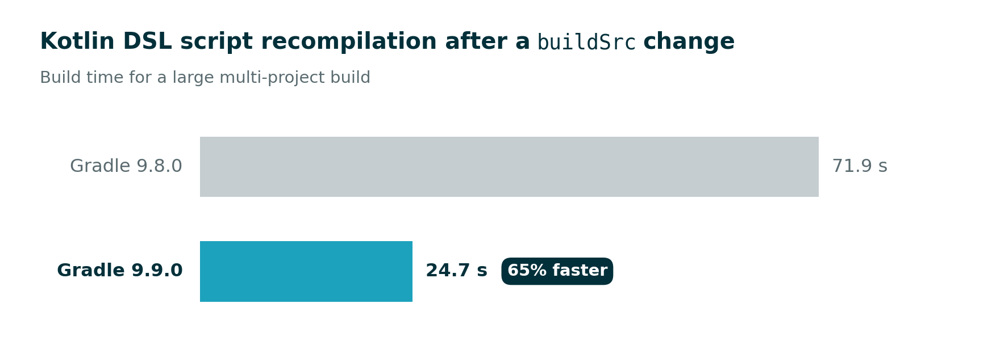
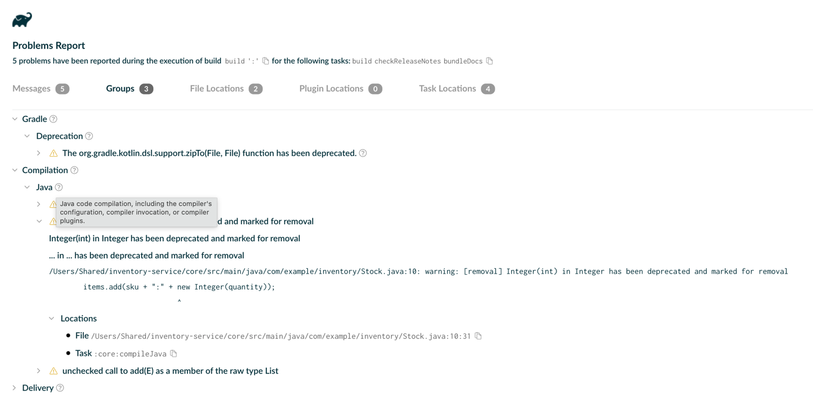

<meta property="og:image" content="https://gradle.org/assets/images/releases/gradle-default.png" />
<meta property="og:type"  content="article" />
<meta property="og:title" content="Gradle @version@ Release Notes" />
<meta property="og:site_name" content="Gradle Release Notes">
<meta property="og:description" content="We are excited to announce Gradle @version@.">
<meta name="twitter:card" content="summary_large_image">
<meta name="twitter:site" content="@gradle">
<meta name="twitter:creator" content="@gradle">
<meta name="twitter:title" content="Gradle @version@ Release Notes">
<meta name="twitter:description" content="We are excited to announce Gradle @version@.">
<meta name="twitter:image" content="https://gradle.org/assets/images/releases/gradle-default.png">

We are excited to announce Gradle @version@ (released [@releaseDate@](https://gradle.org/releases/)).

In this release, Kotlin DSL scripts benefit from [incremental compilation](#performance-improvements), making script recompilation after a change in `buildSrc` or an included build up to 65% faster in large multi-project builds.

[Test filters](#test-reporting-and-execution) now also apply to JUnit Platform tests that are not declared as methods, such as ArchUnit rules and Spek scopes, so `--tests` runs only the tests you select.

In [CLI, logging, and problem reporting](#cli-logging-and-problem-reporting), the Problems API groups problems by area, such as `Compilation > Java`, so you can see where each one comes from, and Windows Terminal shows build progress on the taskbar.

[Build authoring](#build-authoring-improvements) becomes more convenient, with the wrapper task preserving customized properties when you regenerate it, and new `ProviderFactory` methods.

For [plugin authors](#core-plugin-and-plugin-authoring-enhancements), the `Sync` task can now empty its destination when its source is empty.

Finally, [Eclipse users](#tooling-and-ide-integration) can now sync builds that have Isolated Projects enabled, and the [User Manual](#documentation-and-training) is now also available as Markdown and gains a new chapter on securing Gradle builds.

We would like to thank the following community members for their contributions to this release of Gradle:
[devareddy05](https://github.com/devareddy05),
[DragonFSKY](https://github.com/DragonFSKY),
[fru1tworld](https://github.com/fru1tworld),
[Ivan Khanas](https://github.com/ikxeno),
[Jeremy Schoemaker](https://github.com/shoemoney),
[John Burns](https://github.com/wakingrufus),
[Labh R Jethe](https://github.com/itsCodeTide),
[monkey](https://github.com/Develop-KIM),
[Nelson Osacky](https://github.com/runningcode),
[Roberto Perez Alcolea](https://github.com/rpalcolea),
[Róbert Papp](https://github.com/TWiStErRob),
[SeungTaek Lim](https://github.com/namest504),
[Stefan Oehme](https://github.com/oehme),
[万彬宇](https://github.com/Wanbinyu),
[한의준](https://github.com/exijn).

Be sure to check out the [public roadmap](https://roadmap.gradle.org) for insight into what's planned for future releases.

## Upgrade instructions

Switch your build to use Gradle @version@ by updating the [wrapper](userguide/gradle_wrapper.html) in your project:

```text
./gradlew :wrapper --gradle-version=@version@ && ./gradlew :wrapper
```

See the [Gradle 9.x upgrade guide](userguide/upgrading_version_9.html#changes_@baseVersion@) to learn about deprecations, breaking changes, and other considerations when upgrading to Gradle @version@.

For Java, Groovy, Kotlin, and Android compatibility, see the [full compatibility notes](userguide/compatibility.html).   

## New features and usability improvements

### Performance improvements
Gradle continuously improves [build performance](userguide/performance.html) through caching, parallelism, and reduced overhead across all phases of the build.

#### Incremental compilation of Kotlin DSL scripts
[Kotlin DSL](userguide/kotlin_dsl.html) scripts are now compiled using the [Kotlin Build Tools API](https://kotlinlang.org/docs/build-tools-api.html), making incremental compilation available for build scripts.



When a script has to be recompiled, for example, after a signature change in `buildSrc` or an included build, only the affected parts are compiled again. In one of our performance tests on a large multi-project build, this makes recompiling scripts 65% faster.

Builds that rarely recompile scripts see no change.

### Test reporting and execution
Gradle provides a [set of features and abstractions](userguide/java_testing.html) for testing JVM code, along with test reports to display results.

#### Test filters apply to JUnit Platform tests that are not declared as methods
[Test filters](userguide/java_testing.html#test_filtering) now apply to JUnit Platform tests that are not declared as methods, such as [ArchUnit](https://www.archunit.org/) rules declared on fields with `@ArchTest`, or [Spek](https://www.spekframework.org/) scopes.  
Previously, Gradle ran these tests under any filter unless their whole class was excluded, so they ran even when you filtered for something else:

```bash
# Previously also ran every ArchUnit rule in the source set; now runs only SomeUnrelatedTest
./gradlew test --tests "SomeUnrelatedTest"
```

Gradle now matches these tests by their enclosing class and the name they are reported with, the same way it matches test methods by class and method name.  
Rules grouped with `ArchTests.in(...)` are matched by the grouped class instead of the field that holds them:

```bash
# Runs only the rule declared in the `firstRule` field of ArchRulesTest
./gradlew test --tests "ArchRulesTest.firstRule"

# Runs a rule grouped with ArchTests.in(NestedRules.class)
./gradlew test --tests "ArchRulesTest.NestedRules > nestedRule"
```

Tests that an engine registers only during execution, as [Kotest](https://kotest.io/) does, can still only be selected by their spec class.

This also improves the [Test Retry plugin](https://github.com/gradle/test-retry-gradle-plugin), which uses test filters to select tests to rerun.  
Previously, it reran every non-method-based test whenever any test in the task was retried, even ones that had passed. 
Now it reruns only the failed ones.

See the [Upgrade Guide](userguide/upgrading_version_9.html#filters_apply_to_non_method_tests) for breaking changes, and the [Filtering Non-Method Tests](userguide/java_testing.html#filtering_non_method_tests) section in the Gradle User Manual for more details.

### CLI, logging, and problem reporting
Gradle provides an intuitive [command-line interface](userguide/command_line_interface.html), detailed [logs](userguide/logging.html), and a structured [problems report](userguide/reporting_problems.html#sec:generated_html_report) that helps developers quickly identify and resolve build issues.

#### Predefined groups in the Problems API
The incubating [Problems API](userguide/reporting_problems.html#header) now provides a predefined hierarchy of problem groups, available from the `Problems` service as `problems.groups`.

Eleven root groups cover the areas a problem can come from, each with predefined subgroups: `Compilation > Java`, `Dependencies > Declaration`, `Packaging > Signing`, `Provisioning > Tools and Toolchains`, `Gradle > Plugin Validation,` and so on. Plugins report into the matching predefined group or add a subgroup below it. The types of hierarchy enforce placement:

```kotlin
problems.reporter.report(problems.groups.compilation.java.problemId("Unused import")) {}
problems.reporter.report(problems.groups.transformation.group("KMP").problemId("Bundle failed")) {}
```

Each predefined group carries a description of what belongs in it, so consumers of problem reports have a documented set of group names to navigate, filter, and aggregate by.

On the console, problems now show the chain of groups they belong to, for example, `Unused import (in Compilation > Java)`. The Groups tab of the HTML problems report lists the root groups in the order of the predefined hierarchy and shows the description of each predefined group.

The existing `ProblemGroup.create()` and `ProblemId.create()` methods continue to work, and a group created with them whose name matches a predefined group is now reported as that predefined group; migrating to predefined groups is recommended.



The legacy problem groups are gone, and both the groups and the names of Gradle's own problem IDs have changed, so Tooling API clients, Build Scans, and any tooling that matches problems by ID need to update.

See the upgrade guide for the complete list of changed problem IDs:

* [Deprecation](userguide/upgrading_version_9.html#deprecation_problem_ids_moved_to_predefined_groups)
* [Compilation](userguide/upgrading_version_9.html#compilation_problem_ids_moved_to_predefined_groups)
* [Dependency](userguide/upgrading_version_9.html#dependency_problem_ids_moved_to_predefined_groups)
* [Validation](userguide/upgrading_version_9.html#validation_problem_ids_moved_to_predefined_groups)
* [Runtime](userguide/upgrading_version_9.html#runtime_problem_ids_moved_to_predefined_groups)

See the [Predefined Problem Groups](userguide/reporting_problems.html#sec:predefined_problem_groups) section in the Gradle User Manual for more details.

#### Taskbar progress in Windows Terminal
When Gradle runs in [Windows Terminal](https://learn.microsoft.com/en-us/windows/terminal/) 1.6 or later, the build progress shown in the console now also appears on the Windows taskbar icon, including in WSL shells hosted by Windows Terminal. This shows how far a long-running build has progressed while the terminal is in the background.

Gradle already reports progress this way to ConEmu, Ghostty, kitty, and iTerm2.

See the [Rich console](userguide/command_line_interface.html#sec:rich_console) section in the Gradle User Manual for more details.

### General improvements
Gradle provides various incremental updates and optimizations to ensure the continued reliability of the build ecosystem.

#### The `wrapper` task preserves customized properties
The [`wrapper`](userguide/gradle_wrapper.html#gradle_wrapper) task now preserves values from an existing `gradle-wrapper.properties` file when you regenerate the wrapper, for example, with `./gradlew wrapper --gradle-version @version@`.  
Previously, the task overwrote them with defaults.

Gradle preserves the distribution type (`bin` or `all`), the network timeout, retries, and retry backoff, URL validation, and the distribution and archive paths and bases.  
Values configured on the task or passed on the command line still take precedence.  
The `distributionUrl` is regenerated for the new Gradle version, so a custom host is not preserved.

URL validation is preserved like any other value, so a single `--no-validate-url` run disables validation until you run the task again with `--validate-url`.

User-declared `Wrapper` tasks now also write the default network timeout, retry count, and retry backoff when those properties are not otherwise configured.

See the [Preserving Existing Wrapper Properties](userguide/gradle_wrapper.html#sec:preserving_wrapper_properties) section in the Gradle User Manual for more details.

### Build authoring improvements
Gradle provides [rich APIs](userguide/getting_started_dev.html) for build engineers and plugin authors, enabling the creation of custom, reusable build logic and better maintainability.

#### Providers for values that are already known
Build logic often has a value at hand and needs to pass it to an API that accepts a [`Provider`](javadoc/org/gradle/api/provider/Provider.html). Previously, this required wrapping the value in a `Callable` with `providers.provider { value }`, or `providers.provider { null }` for a provider that has no value.

[`ProviderFactory`](javadoc/org/gradle/api/provider/ProviderFactory.html) now has three incubating methods for these cases:

* [`absent()`](javadoc/org/gradle/api/provider/ProviderFactory.html#absent()) returns a provider that never has a value.
* [`present(value)`](javadoc/org/gradle/api/provider/ProviderFactory.html#present(T)) returns a provider that always has the given value.
* [`presentIfNotNull(value)`](javadoc/org/gradle/api/provider/ProviderFactory.html#presentIfNotNull(T)) returns a provider that has the given value when it is not `null`, and has no value otherwise.

```kotlin
val missing: Provider<String> = providers.absent()
val name: PresentProvider<String> = providers.present("my-lib")
val value: Provider<String> = providers.presentIfNotNull(nullableValue)
```

Unlike `provider(Callable)`, these methods do not compute the value on demand, so prefer them when the value is already known.

`present(value)` returns the new [`PresentProvider`](javadoc/org/gradle/api/provider/PresentProvider.html) type, a `Provider` that is guaranteed to have a value: its `get()` never fails, and its `getOrNull()` never returns `null`.

See the [Lazy Objects API Reference](userguide/lazy_configuration.html#lazy_objects_api_reference) section in the Gradle User Manual for more details.

### Core plugin and plugin authoring enhancements
Gradle provides a comprehensive plugin system, including built-in [Core Plugins](userguide/plugin_reference.html) for standard tasks and powerful APIs for creating custom plugins.

#### `Sync` can empty its destination when its source is empty
A [`Sync`](dsl/org.gradle.api.tasks.Sync.html) task works like `Copy`, but its destination directory contains only the files it copied; anything else in the destination is deleted. `Sync` now has an incubating `skipWhenSourceIsEmpty` property. Set it to `false` to make the task run when its source is empty, so the destination directory ends up empty too:

```kotlin
tasks.named<Sync>("mySync") {
    skipWhenSourceIsEmpty = false
}
```

By default, `Sync` still skips the task when its source has no files or directories. Gradle then cleans up the destination only if the build owns it, such as a directory under `build/`. Any other destination keeps files that the source no longer contains.

`Sync` always deletes the entire contents of its destination, not only the files it copied there. With `skipWhenSourceIsEmpty` disabled, an empty source also deletes everything, even when the source is empty by mistake. Disable it only for destinations that no other task or tool writes to, and use `preserve { ... }` to keep files the task does not manage.

See [Synchronizing from an empty source](userguide/working_with_files.html#sec:sync_task_empty_source) in the Gradle User Manual for more details.

### Isolated Projects
[Isolated Projects](userguide/isolated_projects.html) is an incubating performance feature that safely runs project configuration in parallel, significantly reducing configuration time in many scenarios, including IDE sync and CI builds.

#### Eclipse sync works with Isolated Projects
[Buildship](https://projects.eclipse.org/projects/tools.buildship), the Gradle integration for Eclipse, can now synchronize builds that have [Isolated Projects](userguide/isolated_projects.html) enabled.

Previously, synchronizing such a build in Eclipse failed because the Eclipse tooling models read the state of other projects in a way that Isolated Projects reports as a [constraint violation](userguide/isolated_projects.html#sec:constraints). Gradle now builds these models without breaking project isolation, so Eclipse users can adopt Isolated Projects alongside users of IntelliJ IDEA and Android Studio.

Builds that do not enable Isolated Projects see no change.

See the [Isolated Projects](userguide/isolated_projects.html) section in the Gradle User Manual for more details.

## Promoted features

Promoted features are features that were incubating in previous versions of Gradle but are now supported and subject to backward compatibility.
See the User Manual section on the "[Feature Lifecycle](userguide/feature_lifecycle.html)" for more information.

The following are the features that have been promoted in this Gradle release.

### Custom `dependencies` block API
The remaining incubating parts of the API for [custom `dependencies` blocks](userguide/implementing_gradle_plugins_binary.html#custom_dependencies_blocks) have been promoted:

* [`add(ProviderConvertible)`](javadoc/org/gradle/api/artifacts/dsl/DependencyCollector.html#add(org.gradle.api.provider.ProviderConvertible)) and the `bundle(...)` methods in `DependencyCollector`
* [`constraint(Provider)`](javadoc/org/gradle/api/artifacts/dsl/Dependencies.html#constraint(org.gradle.api.provider.Provider)) and [`constraint(ProviderConvertible)`](javadoc/org/gradle/api/artifacts/dsl/Dependencies.html#constraint(org.gradle.api.provider.ProviderConvertible)) in `Dependencies`
* [`modify(ProviderConvertible)`](javadoc/org/gradle/api/artifacts/dsl/DependencyModifier.html#modify(org.gradle.api.provider.ProviderConvertible)) in `DependencyModifier`
* [`DependencyConstraintFactory`](javadoc/org/gradle/api/artifacts/dsl/DependencyConstraintFactory.html)
* [`PlatformDependencyModifiers`](javadoc/org/gradle/api/plugins/jvm/PlatformDependencyModifiers.html) and [`TestFixturesDependencyModifiers`](javadoc/org/gradle/api/plugins/jvm/TestFixturesDependencyModifiers.html)

### `AndSpec.findUnsatisfiedSpec`
[`AndSpec.findUnsatisfiedSpec(T)`](javadoc/org/gradle/api/specs/AndSpec.html#findUnsatisfiedSpec(T)) has been promoted.
Use it to find the first member spec that an object does not satisfy.

## Documentation and training

### User Manual
Every page of the User Manual is now also available as Markdown, so AI agents and other tools can read the documentation directly. Replace `.html` with `.md` in a page's URL, for example, [userguide/gradle_wrapper.md](userguide/gradle_wrapper.md).

A new chapter, [Securing Gradle Builds,](userguide/security.html) covers securing the [build tool](userguide/securing_build_tool.html), [repositories](userguide/securing_repositories.html), and [dependencies](userguide/securing_dependencies.html).

The rewrite of the core plugin reference pages continues with the [Java](userguide/java_plugin.html), [Java Library](userguide/java_library_plugin.html), [Java Platform](userguide/java_platform_plugin.html), [Java Test Fixtures](userguide/java_test_fixtures_plugin.html), [JVM Test Suite](userguide/jvm_test_suite_plugin.html), [JaCoCo](userguide/jacoco_plugin.html), [War](userguide/war_plugin.html), [Distribution](userguide/distribution_plugin.html), and [Version Catalog](userguide/version_catalog_plugin.html) plugins. The [Build Init plugin](userguide/build_init_plugin.html) page now documents the test frameworks it supports.

Other notable additions:

- The [Compatibility Matrix](userguide/compatibility.html) now includes a new [Groovy](userguide/compatibility.html#groovy_compatibility) section, and its tables can be sorted.
- The [Validating Plugins](userguide/validation_problems.html) page is back in the User Manual.
- The [Worker API](userguide/worker_api.html#work_parameter_types) page lists the supported `WorkParameters` property types.

### Best Practices
A new entry has been added to the [Best Practices](userguide/best_practices.html):

- [Favor `String` values for custom attributes](userguide/best_practices_dependencies.html#favor_string_attribute_values) over `Named` types, since attribute values are published as plain strings.


## Fixed issues

<!--
This section will be populated automatically
-->

## Known issues

Known issues are problems that were discovered post-release that are directly related to changes made in this release.

<!--
This section will be populated automatically
-->

## External contributions

We love getting contributions from the Gradle community. For information on contributing, please see [gradle.org/contribute](https://gradle.org/contribute).

## Reporting problems

If you find a problem with this release, please file a bug on [GitHub Issues](https://github.com/gradle/gradle/issues) adhering to our issue guidelines.
If you're not sure if you're encountering a bug, please use the [forum](https://discuss.gradle.org/c/help-discuss).

We hope you will build happiness with Gradle, and we look forward to your feedback via [Twitter](https://twitter.com/gradle) or on [GitHub](https://github.com/gradle).
