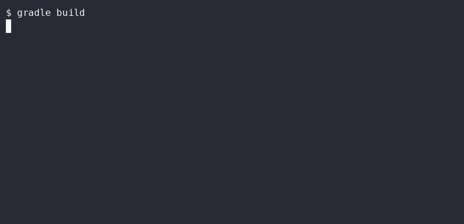

<meta property="og:image" content="https://gradle.org/assets/images/releases/gradle-default.png" />
<meta property="og:type"  content="article" />
<meta property="og:title" content="Gradle @version@ Release Notes" />
<meta property="og:site_name" content="Gradle Release Notes">
<meta property="og:description" content="We are excited to announce Gradle @version@.">
<meta name="twitter:card" content="summary_large_image">
<meta name="twitter:site" content="@gradle">
<meta name="twitter:creator" content="@gradle">
<meta name="twitter:title" content="Gradle @version@ Release Notes">
<meta name="twitter:description" content="We are excited to announce Gradle @version@.">
<meta name="twitter:image" content="https://gradle.org/assets/images/releases/gradle-default.png">

We are excited to announce Gradle @version@ (released [@releaseDate@](https://gradle.org/releases/)).

This release features [1](), [2](), ... [n](), and more.

We would like to thank the following community members for their contributions to this release of Gradle:

<!-- 
Include only their name, impactful features should be called out separately below.
 [Some person](https://github.com/some-person)

THIS LIST SHOULD BE ALPHABETIZED BY [PERSON NAME] - the docs:updateContributorsInReleaseNotes task will enforce this ordering, which is case-insensitive.
-->

Be sure to check out the [public roadmap](https://roadmap.gradle.org) for insight into what's planned for future releases.

## Upgrade instructions

Switch your build to use Gradle @version@ by updating the [wrapper](userguide/gradle_wrapper.html) in your project:

```text
./gradlew :wrapper --gradle-version=@version@ && ./gradlew :wrapper
```

See the [Gradle 9.x upgrade guide](userguide/upgrading_version_9.html#changes_@baseVersion@) to learn about deprecations, breaking changes, and other considerations when upgrading to Gradle @version@.

For Java, Groovy, Kotlin, and Android compatibility, see the [full compatibility notes](userguide/compatibility.html).   

## New features and usability improvements

<!-- ================== TEMPLATE =============================

Do not add breaking changes or deprecations here! Add them to the upgrade guide instead.

Find the best fitting section for your feature below, then, fill it in.

### SECTION TITLE

#### FILL-IN-FEATURE
> HIGHLIGHT the use case or existing problem the feature solves.
> EXPLAIN how the new release addresses that problem or use case.
> PROVIDE a screenshot or snippet illustrating the new feature, if applicable.
> LINK to the full documentation for more details.

To embed images, add the image to the `release-notes-assets` folder, then add the line below.


To embed videos, use the macros below. 
You can extract the URL from YouTube by clicking the "Share" button.
@youtube(Summary,6aRM8lAYyUA?si=qeXDSX8_8hpVmH01)@

================== END TEMPLATE ========================== -->


<!-- =========================================================
ADD RELEASE FEATURES BELOW
vvvvvvvvvvvvvvvvvvvvvvvvvvvvvvvvvvvvvvvvvvvvvvvvvvvvvvvvvv -->

### Isolated Projects
[Isolated Projects](userguide/isolated_projects.html) is an incubating performance feature that safely runs project configuration in parallel, significantly reducing configuration time in many scenarios, including IDE sync and CI builds.

### Configuration Cache improvements
Gradle provides a [Configuration Cache](userguide/configuration_cache.html) that improves build time by caching the result of the configuration phase and reusing it for subsequent builds.

### Test reporting and execution
Gradle provides a [set of features and abstractions](userguide/java_testing.html) for testing JVM code, along with test reports to display results.

### CLI, logging, and problem reporting
Gradle provides an intuitive [command-line interface](userguide/command_line_interface.html), detailed [logs](userguide/logging.html), and a structured [problems report](userguide/reporting_problems.html#sec:generated_html_report) that helps developers quickly identify and resolve build issues.

#### Rich console improvements

In the [rich console](userguide/command_line_interface.html#sec:rich_console), the work in progress is shown on worker lines, below the progress bar.
In this release, more work is shown on these lines, and more information is shown on each line.



Before, some work had no worker line of its own.
This work is now shown on worker lines:

* Before the tasks: the check of the configuration cache fingerprint, the `projectsLoaded`, `projectsEvaluated` and `taskGraph.whenReady` listeners, and the generation of [version catalog](userguide/version_catalogs.html) and project accessors.
* After the last task: [flow actions](userguide/dataflow_actions.html), the `close()` method of [build services](userguide/build_services.html), and the write operations for dependency locks and dependency verification metadata.
* During a task: the work actions of the task, such as the ones submitted with the [Worker API](userguide/worker_api.html). When a task has more than one work action, each work action in progress is shown on its own line. The number of completed work actions is shown on the line of the task, as for test tasks.

For the work of an included build, the path of the build is put first, as in `> :lib > Running projects evaluated listeners`.

More information is also shown on each worker line:

* After 10 seconds of work on a line, the time since the start of this work is shown at the end of the line. For a test task, the time of the current test class is shown. With this time, you can see the difference between a blocked task and a new task.
* When a line is too long for the console, the middle of the line is cut. The task path at the start and the end of the line are kept. Before, the end of the line was cut, and the name of a test class was often lost:

```text
Before  > :services:payments:test > Executing test com.example.payments.retry.SlowNetwo
After   > :services:payments:test > ...retry.SlowNetworkRetryIntegrationTest  25s
```

On the Linux text console, the progress bar is now drawn with ASCII characters.
The fonts of this console do not have the partial block characters of the Unicode bar, so a replacement character was shown at the edge of the filled part.
With [`--console-unicode=enable`](userguide/command_line_interface.html#sec:command_line_customizing_log_format), the Unicode bar is still used.

### Build authoring improvements
Gradle provides [rich APIs](userguide/getting_started_dev.html) for build engineers and plugin authors, enabling the creation of custom, reusable build logic and better maintainability.

### Dependency management enhancements
Gradle provides a flexible [dependency management](userguide/getting_started_dep_man.html) engine for declaring, resolving, and verifying the dependencies your build needs.

### Platform and toolchain management
Gradle provides comprehensive support for [JVM languages](userguide/building_java_projects.html), featuring automated [Toolchains](userguide/toolchains.html) for seamless JDK management.

### Core plugin and plugin authoring enhancements
Gradle provides a comprehensive plugin system, including built-in [Core Plugins](userguide/plugin_reference.html) for standard tasks and powerful APIs for creating custom plugins.

### Security and infrastructure
Gradle provides robust [security features and underlying infrastructure](userguide/security.html) to ensure that builds are secure, reproducible, and easy to maintain.

### Tooling and IDE integration
Gradle provides [Tooling APIs](userguide/third_party_integration.html) that facilitate deep integration with modern IDEs and CI/CD pipelines.

### Performance improvements
Gradle continuously improves [build performance](userguide/performance.html) through caching, parallelism, and reduced overhead across all phases of the build.

### General improvements
Gradle provides various incremental updates and performance optimizations to ensure the continued reliability of the build ecosystem.

<!-- ^^^^^^^^^^^^^^^^^^^^^^^^^^^^^^^^^^^^^^^^^^^^^^^^^^^^^^^^^
ADD RELEASE FEATURES ABOVE
========================================================== -->

## Promoted features

Promoted features are features that were incubating in previous versions of Gradle but are now supported and subject to backward compatibility.
See the User Manual section on the "[Feature Lifecycle](userguide/feature_lifecycle.html)" for more information.

The following are the features that have been promoted in this Gradle release.

<!--
### Example promoted
-->

## Documentation and training

<!--
Add new docs, training, and best practices here
-->

## Fixed issues

<!--
This section will be populated automatically
-->

## Known issues

Known issues are problems that were discovered post-release that are directly related to changes made in this release.

<!--
This section will be populated automatically
-->

## External contributions

We love getting contributions from the Gradle community. For information on contributing, please see [gradle.org/contribute](https://gradle.org/contribute).

## Reporting problems

If you find a problem with this release, please file a bug on [GitHub Issues](https://github.com/gradle/gradle/issues) adhering to our issue guidelines.
If you're not sure if you're encountering a bug, please use the [forum](https://discuss.gradle.org/c/help-discuss).

We hope you will build happiness with Gradle, and we look forward to your feedback via [Twitter](https://twitter.com/gradle) or on [GitHub](https://github.com/gradle).
